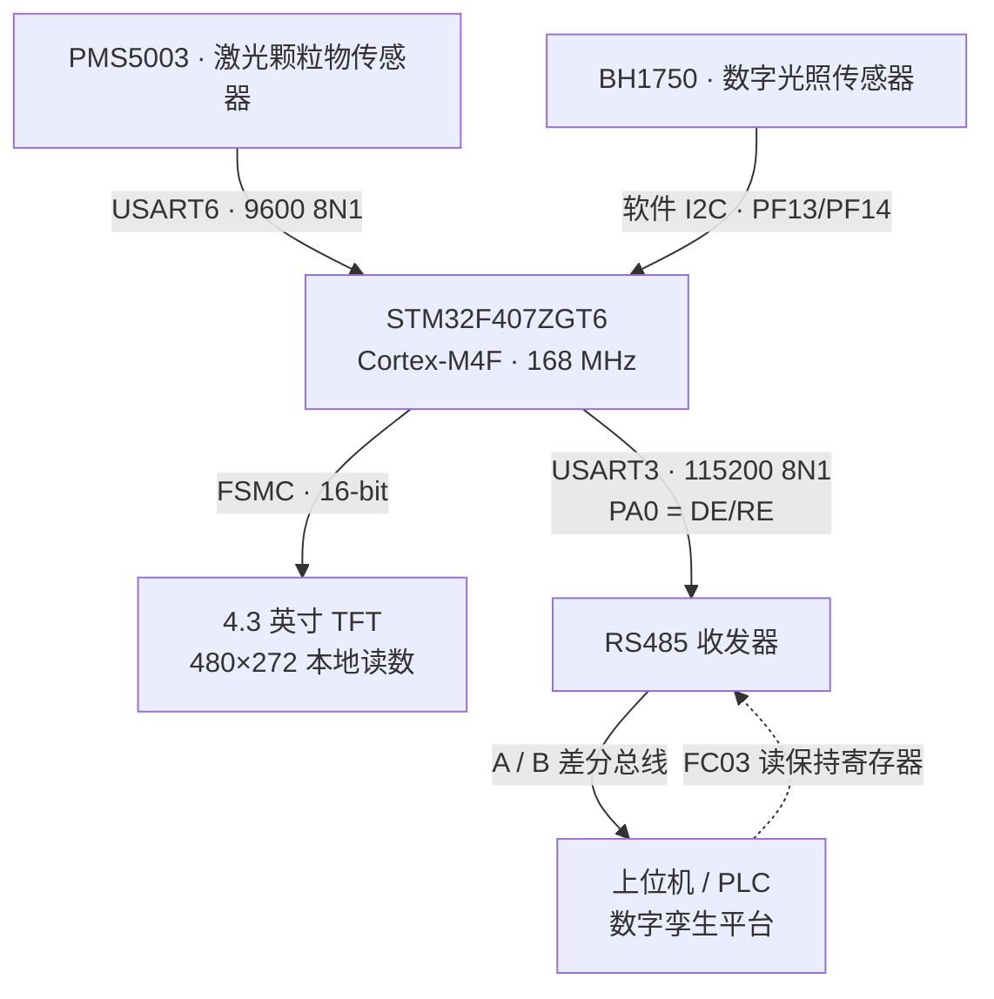

<div align="center">

# STM32F407 Environmental Sensing Node · Modbus RTU Slave

**STM32F407 环境数据采集节点 · Modbus RTU 从站**

采集 PM2.5 / PM10 / 光照度，通过 RS485 以标准 Modbus RTU 协议供上位机、PLC 或数字孪生平台读取。

[](#硬件)
[](#快速开始)
[](#modbus-接口)
[](#构建验证)
[](LICENSE)

[中文](#中文) · [English](#english)

</div>

---

## 中文

### 项目简介

这是一个运行在 **STM32F407ZGT6** 上的环境数据采集节点：板载激光颗粒物传感器采集 PM2.5 / PM10，数字光照传感器采集照度，本地 4.3 寸 TFT 屏幕实时显示读数，同时以 **Modbus RTU 从站**（RS485 半双工）对外提供标准寄存器接口，上位机 / PLC / 数字孪生平台按需轮询即可拿到结构化数据。

项目刻意把「采集」和「通信」解耦：`sensor_env` 负责传感器时序与数据聚合，`modbus_rtu` 只依赖一个 `EnvSensor_Typedef` 结构体，因此换传感器不影响协议层，换通信方式（LoRa、以太网）也不影响业务层。

### 功能特性

- **标准 Modbus RTU 从站**：从机地址 `0x01`，功能码 `0x03`，CRC16（多项式 `0xA001`，低字节先发）
- **4 个保持寄存器**：PM2.5、PM10、照度、设备状态位
- **规范的异常响应**：非法功能码 / 非法地址 / 非法数据值分别返回 `0x01` / `0x02` / `0x03`
- **帧静默检测**：USART3 中断逐字节接收 + TIM7 计时，总线静默 1.75 ms 判定一帧结束
- **异常容错**：CRC 错、地址不符、报文不完整时静默丢帧；接收溢出自动清零，不会锁死
- **状态自诊断**：状态寄存器按位上报传感器错误、数据未就绪、响应超时
- **本地显示**：480×272 TFT（FSMC）1 Hz 刷新，可脱离上位机独立观察
- **开箱即用**：Keil MDK 工程与 ST 标准外设库已随仓库提供，clone 后直接编译

### 系统架构



**数据流**：`main()` 主循环里 `Modbus_RTU_Poll()` 不断检查是否有完整帧；同时 SysTick 每 1 s 置位一次刷新标志，主循环调用 `EnvSensor_Read()` 读 BH1750、触发一次 PMS 采集，更新结构体并刷新屏幕。Modbus 应答读取的正是这个结构体的最新快照，因此传感器刷新节奏不影响总线响应。

### 硬件

| 部件 Component | 型号 Model | 接口 Interface | 说明 Notes |
| --- | --- | --- | --- |
| 主控 MCU | STM32F407ZGT6 | — | Cortex-M4F，168 MHz，1 MB Flash |
| 颗粒物传感器 | PMS5003（激光） | USART6 · PC6/PC7 · 9600 8N1 | 支持主动/被动模式，本例使用问答式 |
| 光照传感器 | BH1750FVI | 软件 I2C · PF13=SCL / PF14=SDA · 0x46 | H-Resolution 模式，1–65535 lx |
| 显示屏 | 4.3" TFT 480×272（SSD1963 类） | FSMC Bank1 NE4 · 16-bit | RS = PG1(A11)，CS = PG12，背光 PA9 |
| 总线收发 | RS485 收发器（MAX3485 等） | USART3 · PC10=TX / PC11=RX | PA0 控制 DE/RE：1 发送，0 接收 |

完整引脚表、接线与注意事项见 **[docs/hardware.md](docs/hardware.md)**。

### Modbus 接口

- 从机地址 `0x01`，波特率 `115200`，数据位 `8`，停止位 `1`，无校验
- 支持功能码：`0x03` 读保持寄存器（一次最多读 4 个）

| 地址 Addr | 名称 Register | 单位 Unit | 说明 Notes |
| --- | --- | --- | --- |
| `0x0000` | PM2.5 | µg/m³ | PMS5003 大气环境换算值 |
| `0x0001` | PM10 | µg/m³ | 同上 |
| `0x0002` | 照度 Illuminance | lx | BH1750 原始值 ×10/12 取整 |
| `0x0003` | 设备状态 Device Status | bitfield | 见下表 |

| 位 Bit | 含义 Meaning |
| --- | --- |
| `bit0` | PM2.5 数据错误 |
| `bit1` | PM10 数据错误 |
| `bit2` | BH1750 数据异常 |
| `bit3` | 尚未完成第一次采集 |
| `bit4` | 传感器响应超时 |

请求与应答示例：

```text
请求 01 03 00 00 00 04 44 09          # 读 0x0000 起 4 个寄存器
应答 01 03 08 00 1A 00 2B 01 2C 00 00 CA 25
      # PM2.5=26 µg/m³, PM10=43 µg/m³, 照度=300 lx, 状态=0
```

帧格式、异常码、更多示例与 CRC 校验见 **[docs/modbus-protocol.md](docs/modbus-protocol.md)**。

### 快速开始

```bash
git clone https://github.com/roza2006/g407-environment-data-acquisition-modbus-.git
```

1. 用 **Keil MDK 5** 打开 `Project/G407_EnvNode.uvprojx`
2. `F7` 编译（ARMCC 5.06，目标 `STM32F407ZGTx`）
3. 用 ST-Link / J-Link 下载 `Project/Obj/G407_EnvNode.hex`
4. 按 [docs/hardware.md](docs/hardware.md) 接好 RS485（A/B、共地）与传感器
5. 用 Modbus Poll、QModMaster 或仓库自带脚本读取：

```bash
pip install pyserial
python tools/modbus_poll.py --port COM5 --interval 1
```

> 没有硬件也可以先跑 `python tools/modbus_poll.py --selftest`，验证 CRC 与报文解析。

### 目录结构

```text
.
├── App/          应用层：主流程、Modbus 从站、传感器数据聚合
├── BSP/          板级支持：USART3(RS485)、USART6(PM)、SysTick 延时
├── Driver/       器件驱动：PMS5003、BH1750、软件 I2C、LED
├── Display/      4.3" TFT 驱动（FSMC）与点阵字库
├── User/         中断服务、外设总配置头
├── Libraries/    CMSIS + STM32F4xx 标准外设库（ST 官方，保留原始许可）
├── Project/      Keil MDK 工程、清理脚本
├── docs/         协议、硬件、上手指南、架构、已知问题
└── tools/        上位机侧 Python 工具
```

### 文档索引

| 文档 Document | 内容 Content |
| --- | --- |
| [docs/modbus-protocol.md](docs/modbus-protocol.md) | 寄存器映射、帧格式、异常码、CRC 示例 |
| [docs/hardware.md](docs/hardware.md) | 接线表、引脚复用、传感器配置 |
| [docs/getting-started.md](docs/getting-started.md) | 环境准备、编译、下载、联调、排错 |
| [docs/architecture.md](docs/architecture.md) | 分层设计、时序、状态机与取舍 |
| [docs/known-issues.md](docs/known-issues.md) | 已知问题与改进路线 |

### 构建验证

在 Keil MDK 5.38 + ARMCC 5.06 update 5 下实测：

```text
Program Size: Code=19500  RO-data=274128  RW-data=76  ZI-data=3452
".\Obj\G407_EnvNode.axf" - 0 Error(s), 0 Warning(s).
```

`RO-data` 主要是 `Display/Hzk16song.h` 中的 16×16 汉字字库。

### 路线图

- [ ] 支持 `0x04` 输入寄存器与 `0x06/0x10` 写寄存器（阈值配置）
- [ ] 增加 CRC 自检调用与主机侧单元测试
- [ ] 传感器数据滑动平均与超时重试
- [ ] 归一化源码编码（GBK → UTF-8）与跨平台（GCC）构建
- [ ] 增加 IWDG 看门狗与通信失联指示

### 许可证

应用代码使用 [MIT License](LICENSE)。`Libraries/` 下 ST 官方代码遵循其原始许可（见 `Libraries/CMSIS/`）。

---

## English

### Overview

An environmental data acquisition node built on **STM32F407ZGT6**. It samples PM2.5 / PM10 from a laser particulate sensor and illuminance from a digital light sensor, shows the readings on a local 4.3" TFT, and exposes them as a **Modbus RTU slave** over a half-duplex RS485 bus, so a PC, PLC or digital-twin platform can poll structured data on demand.

The acquisition path and the communication path are deliberately decoupled: `sensor_env` owns sensor timing and aggregation, while `modbus_rtu` only sees an `EnvSensor_Typedef` snapshot. Replacing a sensor does not touch the protocol layer, and replacing the physical link (LoRa, Ethernet) does not touch the application logic.

### Features

- **Modbus RTU slave**: address `0x01`, function code `0x03`, CRC16 (`0xA001`, low byte first)
- **Four holding registers**: PM2.5, PM10, illuminance, device status bits
- **Proper exception replies**: `0x01` illegal function, `0x02` illegal address, `0x03` illegal value
- **Inter-frame gap detection**: byte-wise RX interrupt plus a TIM7 timeout (1.75 ms of bus silence ends a frame)
- **Robust framing**: CRC error, wrong address or truncated frames are dropped silently; RX overflow resets instead of dead-locking
- **Self-diagnostics**: the status register reports sensor errors, data-not-ready and timeouts
- **Local display**: 480×272 TFT over FSMC refreshed at 1 Hz
- **Ready to build**: Keil MDK project and the ST standard peripheral library are included

### Quick start

1. Open `Project/G407_EnvNode.uvprojx` in **Keil MDK 5**
2. Build with `F7` (ARMCC 5.06, device `STM32F407ZGTx`)
3. Flash `Project/Obj/G407_EnvNode.hex`
4. Wire RS485 (A/B, common ground) and sensors as described in [docs/hardware.md](docs/hardware.md)
5. Poll it with Modbus Poll, QModMaster, or:

```bash
pip install pyserial
python tools/modbus_poll.py --port COM5 --interval 1
```

Run `python tools/modbus_poll.py --selftest` to verify CRC and frame decoding without hardware.

### Repository layout

| Path | Contents |
| --- | --- |
| `App/` | Application: main loop, Modbus slave, sensor aggregation |
| `BSP/` | Board support: USART3 (RS485), USART6 (PM sensor), SysTick delay |
| `Driver/` | Device drivers: PMS5003, BH1750, bit-banged I2C, LEDs |
| `Display/` | 4.3" TFT driver (FSMC) and bitmap fonts |
| `User/` | Interrupt handlers, peripheral configuration header |
| `Libraries/` | CMSIS + STM32F4xx standard peripheral driver (ST, original licence kept) |
| `Project/` | Keil MDK project and clean script |
| `docs/` | Protocol, hardware, getting started, architecture, known issues |
| `tools/` | Host-side Python utilities |

### Documentation

| Document | Contents |
| --- | --- |
| [docs/modbus-protocol.md](docs/modbus-protocol.md) | Register map, frame layout, exceptions, CRC worked examples |
| [docs/hardware.md](docs/hardware.md) | Pin table, alternate functions, sensor configuration |
| [docs/getting-started.md](docs/getting-started.md) | Toolchain, build, flash, bring-up, troubleshooting |
| [docs/architecture.md](docs/architecture.md) | Layering, timing, state machine, design trade-offs |
| [docs/known-issues.md](docs/known-issues.md) | Known issues and improvement roadmap |

### Build status

Verified with Keil MDK 5.38 + ARMCC 5.06 update 5:

```text
Program Size: Code=19500  RO-data=274128  RW-data=76  ZI-data=3452
0 Error(s), 0 Warning(s)
```

### License

Application code is released under the [MIT License](LICENSE). ST code under `Libraries/` keeps its original licence.
