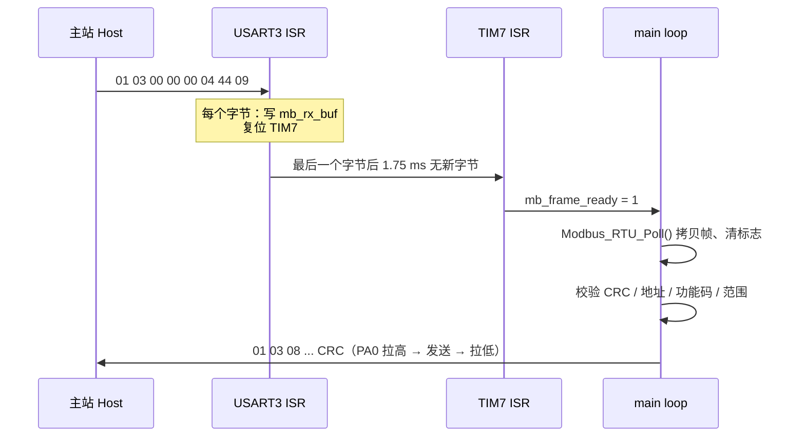

# 架构与实现 · Architecture

> 为什么这样分层、主循环和中断如何协作、时序上有什么取舍。
> How the layers are split, how the ISRs and the main loop cooperate, and the timing trade-offs.

---

## 1. 分层 · Layering

```text
┌──────────────────────────────────────────────────────────────┐
│ App/                                                         │
│   main.c          初始化顺序、主循环、1 Hz 屏幕刷新           │
│   modbus_rtu.c    帧解析、寄存器映射、CRC、应答发送           │
│   sensor_env.c    传感器读取与状态位聚合（唯一的数据模型）     │
└───────────────▲──────────────────────────▲───────────────────┘
                │ EnvSensor_Typedef        │ Modbus 帧
┌───────────────┴──────────────────────────┴───────────────────┐
│ BSP/                                                         │
│   USART3.c  RS485 方向 + Modbus 串口    usart6.c  PM 串口    │
│   delay.c   SysTick 延时                usart6_var.c 接收缓冲 │
└───────────────▲──────────────────────────▲───────────────────┘
                │                          │
┌───────────────┴──────────────────────────┴───────────────────┐
│ Driver/                                                      │
│   PM25.c  PMS5003 协议      BH1750.c  光照传感器              │
│   I2C.c   软件 I2C          LED.c     LED 宏                  │
└───────────────▲──────────────────────────▲───────────────────┘
                │                          │
┌───────────────┴──────────────────────────┴───────────────────┐
│ Display/  lcd.c（FSMC 并口、绘图、字符串）  User/  中断向量  │
└──────────────────────────────────────────────────────────────┘
```

**关键约束**：`modbus_rtu.c` 不包含任何传感器头文件，只依赖 `sensor_env.h` 的结构体定义；`sensor_env.c` 不包含任何串口寄存器操作。这样协议层可以脱离硬件做单元测试，传感器层也可以换通信方式。

---

## 2. 数据模型 · Data Model

整个应用只有一个数据实例：

```c
typedef struct {
    uint16_t pm25;         /* µg/m³ */
    uint16_t pm10;         /* µg/m³ */
    uint16_t illuminance;  /* lx     */
    uint16_t status;       /* 位域，见 docs/modbus-protocol.md */
} EnvSensor_Typedef;
```

- `main()` 里的 `env` 变量是**唯一权威副本**，位于主循环栈上。
- `EnvSensor_Read()` 每 1 s 覆写一次；`Modbus_ParseFrame()` 应答时在**关中断**的临界区里把它拷贝成 4 个寄存器值，保证 4 个值来自同一次采集（不会出现 PM2.5 是新的、PM10 是旧的）。
- 初始化时 `status = ENV_STATUS_DATA_NOT_READY`，第一次采集成功后该位自然消失。

---

## 3. 主循环与中断的协作 · ISR / Main-loop Cooperation



| 共享变量 Shared | 写入方 Writer | 读取方 Reader | 保护 Protection |
| --- | --- | --- | --- |
| `mb_rx_buf[]`, `mb_rx_idx` | USART3 ISR | `Modbus_RTU_Poll` | `__disable_irq()` 区间内拷贝 |
| `mb_frame_ready` | TIM7 ISR | `Modbus_RTU_Poll` | 同上 |
| `screen_refresh_flag` | SysTick ISR | `main` | 单字节写，天然原子 |
| `env` | 主循环 | 主循环 | 无需保护（只在主循环访问） |
| `Uart6ReceiveBuf[]`, `Uart6RXlenth` | USART6 ISR | `PM25Collection` | 依赖 `Uart6ReceiveFinish` 握手 |
| `TimingDelay` | SysTick ISR | `delay_ms` | `volatile` 递减 |

**设计要点**：中断里只做「搬字节 + 计时」，解析和应答全部在主循环完成。这样中断短（微秒级），不会阻塞传感器读取或屏幕刷新；解析耗时（CRC + 组帧，几十微秒）也不影响下一帧接收。

---

## 4. 时序 · Timing

| 事件 Event | 周期 Period | 来源 Source |
| --- | --- | --- |
| SysTick | 1 ms | `SysTick_Config(SystemCoreClock/1000)` |
| 屏幕刷新 / 传感器采集 | 1000 ms | `SysTick_Handler` 计数 1000 |
| Modbus 帧静默判定 | 1.75 ms | TIM7（1 MHz，1750 计数） |
| PMS 应答等待 | 100 ms | `PM25Collection()` 内 `delay_ms(100)` |
| PMS 模式切换重试 | 500 ms × 最多 5 次 | `setPM25Mode()` |
| BH1750 一次转换 | ≈120 ms | 传感器内部（连续 H 模式，无需等待） |

一次完整的采集周期（主循环内）耗时约 100 ms（PMS 应答等待占主导），期间 Modbus 请求不会被漏掉：USART3 中断独立工作，帧会在采集中途缓存下来，采集结束后（≤100 ms）再应答。**主站在 PMS 等待窗口内的超时设置建议 ≥ 200 ms**，否则可能误判掉线。

---

## 5. 关键取舍 · Design Trade-offs

| 决策 Decision | 理由 Rationale | 代价 Cost |
| --- | --- | --- |
| 用 TIM7 做静默检测，而非 UART IDLE 中断 | F4 的 IDLE 中断粒度是 1 字符，且与 DMA 配合才省事；定时器方案逻辑直观、易调 | 多占一个定时器和 1.75 ms 判定延迟 |
| 静默阈值取 1.75 ms 而非规范的 0.30 ms | 容忍 USB-485 转换器的分包抖动 | 帧间最小间隔变大，理论吞吐下降 |
| 阻塞式发送（等 TC） | 半双工必须保证发送完才切回接收；阻塞实现最简单、不会截断 | 发送期间（≈0.7 ms）主循环停顿 |
| 解析放在主循环 | 中断保持极短，逻辑可读、可调试 | 单帧处理延迟 = 主循环剩余路径 |
| 寄存器快照用关中断拷贝 | 避免 4 个寄存器撕裂 | 关中断约几十个周期，可忽略 |
| 仅 FC03、固定从机地址 | 满足「只读采集节点」的最小闭环 | 不能在线改地址/阈值，需重新编译 |
| 字库以头文件形式编进 Flash | 免去文件系统，烧录即用 | Flash 占用 ≈270 KB（总 1 MB 尚可接受） |

---

## 6. 内存占用 · Memory Footprint

实测（ARMCC 5.06，`-O1`）：

```text
Code    = 19,500 B
RO-data = 274,128 B   ← 主要是 Hzk16song.h（16×16 汉字点阵）与 font.h
RW-data =     76 B
ZI-data =  3,452 B
```

- 栈峰值主要在 `Modbus_ParseFrame()`（`uint16_t reg_arr[4]` + `tx_buf[64]`）与 `main()` 的 `disbuf[64]`。
- `Hzk16song.h` 是 1.6 MB 的源文件，编译时间与 IDE 内存占用主要来自它；若在意编译速度，可改为 `const` 数组的 `.c` 文件或用外部 Flash 存储。

---

## 7. 扩展点 · Extension Points

| 想做的事 Goal | 改哪里 Where |
| --- | --- |
| 增加传感器 | 在 `EnvSensor_Typedef` 加字段 → `EnvSensor_Read()` 里填充 → 在 `MODBUS_REG_*` 里加寄存器并同步 `MODBUS_REG_COUNT` |
| 支持写寄存器（改地址/阈值） | `Modbus_ParseFrame()` 增加 `0x06`/`0x10` 分支，注意广播地址与 EEPROM 持久化 |
| 换 RS485 为以太网 | 保留 `Modbus_ParseFrame()`，替换 `Modbus_SendFrame()` 与接收触发源（可用 lwIP + Modbus TCP） |
| 提高实时性 | 把发送改为 DMA + TC 中断，采集放到定时器任务，主循环只做调度 |
| 加看门狗 | `main()` 初始化 IWDG，在主循环成功处理一帧后喂狗 |
